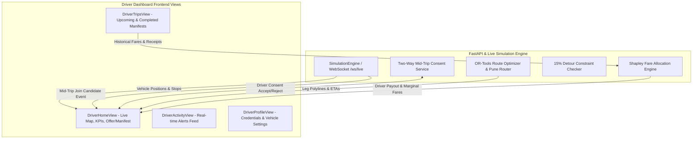

# Implementation Plan: RidePool AI Driver Dashboard

## 1. Executive Summary & Figma Analysis

Based on an interactive inspection of the Figma prototype at [Ride-Pooling Web Application](https://www.figma.com/make/GlXxJUuuvqHPQzPRhHN9ph/Ride-Pooling-Web-Application--Copy-?t=U2DKkPkPcxd4bLcz-1), the **Driver Dashboard** is designed as a dark-sidebar, clean-canvas productivity cockpit for shared-ride drivers. It balances real-time navigation, passenger pickup/drop-off sequences, algorithmic detour transparency, and earnings clarity.

### Key Visual & UX Paradigms Identified in Figma:
1. **Layout Structure**:
   - **Deep Navy Sidebar** (`#0B192C` / `#0F172A`):
     - Branding: "Dynamic Ride Pooling" with connected-nodes icon.
     - Navigation items: `Home`, `Trips`, `Activity`, `Profile`.
     - Bottom controls:
       - **Demo Role Switcher**: Segmented toggle `[ P ] [ D ] [ A ]` (Passenger, Driver, Admin/Ops) for seamless demo switching.
       - **Safety Centre Widget**: Quick access to SOS and roadside safety guidelines.
   - **Top Application Header**:
     - Driver identity: `VERIFIED DRIVER` badge + `Good morning, Arjun` + vehicle subtitle.
     - Right utility cluster: `Prototype · Demo data` badge, Notification bell with unread badge (`3`), Driver avatar circle (`AK`), and Logout.
     - **Driver Status Switch**: Interactive toggle between `Offline` (gray) and `Online` (green).
   - **Top KPI Metric Cards** (3-column responsive grid):
     - **Today's Earnings**: `₹1,840` (`+12% from yesterday`) with Rupee icon badge.
     - **Completed Trips**: `7` (`82.4 km driven`) with Car icon badge.
     - **Driver Rating**: `4.9` (`From 1,248 rides`) with Star icon badge.
   - **Operational Workspace (Split Grid)**:
     - **Left / Center**: Interactive Live Map (Leaflet) with vehicle position marker, pickup/drop-off waypoints, route polyline, and live status pill (`● OpenStreetMap live`, `Demo route`).
     - **Right Panel (Trip Offer & Manifest Card)**:
       - Offer state: Header `● New pooled trip`, animated countdown `Expires in 24s`.
       - Stop sequence: Origin/pickups (`MG Road Metro` / `Shivajinagar`) -> Destination/dropoffs (`Koramangala 5th Block` / `Hinjewadi IT Park`).
       - Metrics: Distance (`11.2 km`), Estimated Time (`38 min`), Seat Occupancy (`2 / 4`).
       - **15% Detour Guarantee Banner**: `"Route validated: Both passengers remain within the 15% detour limit."`
       - Action controls: `[ Decline ]` and `[ Accept trip ]`.
2. **Secondary Views Identified in Prototype**:
   - **Trips ("My rides")**: Filter tabs (`Upcoming`, `Completed`, `Cancelled`), trip summary cards with dates, fare receipts (`₹148`), and `View trip` manifest drawer.
   - **Activity / Notifications**: Activity feed of driver assignment alerts, match confirmations, and payment receipts with `Mark all as read`.
   - **Profile & Settings**: Driver verification credentials, vehicle info, passenger rating, contact preferences, and privacy toggles.

---

## 2. Integration with Current RidePool Architecture

The driver experience will directly bind to the existing live simulation and algorithmic engines:



### Fleet Integration Details:
- **Vehicle Selection**: Drivers can toggle between active fleet vehicles (e.g. `V-101`, `V-102`, `V-103` Tata Tigor EVs) or operate in single-driver mode as `Arjun Kumar (V-101)`.
- **Live Dispatch**: When the Operations Console or dynamic batching triggers a dispatch, the driver dashboard receives the trip offer in real-time via WebSocket.
- **Detour Transparency**: Highlights the exact detour cap adherence (e.g. Passenger A: +4.2%, Passenger B: +7.1%, both $\le 15\%$).
- **Mid-Trip Consent**: When a mid-trip request arrives while en route, the driver dashboard displays the two-way consent card (e.g. `+₹65 extra payout`, `0% extra detour for current rider`).

---

## 3. UI Component Architecture

We will create a modular, clean component hierarchy under `frontend/src/views/driver/` and `frontend/src/components/driver/`:

```
frontend/src/
├── views/
│   └── driver/
│       ├── DriverHomeView.tsx         # Main dashboard: KPIs, Map, Trip Offer / Active Manifest
│       ├── DriverTripsView.tsx        # "My rides": Upcoming, Completed, Cancelled tabs & receipts
│       ├── DriverActivityView.tsx     # Activity notifications feed
│       └── DriverProfileView.tsx      # Driver profile, vehicle stats, verified credentials
├── components/
│   └── driver/
│       ├── DriverSidebar.tsx          # Navy sidebar with Home/Trips/Activity/Profile & [P][D][A] switcher
│       ├── DriverTopHeader.tsx        # Greeting, Online/Offline switch, avatar, notification bell
│       ├── DriverKPISection.tsx       # Earnings (₹), Completed trips, Driver rating cards
│       ├── DriverTripOfferCard.tsx    # "New pooled trip" offer with 24s countdown & 15% detour banner
│       ├── DriverActiveManifest.tsx   # En-route turn-by-turn stop sequence & passenger boarding buttons
│       ├── DriverMidTripConsentModal.tsx # Driver approval card for mid-trip joins with payout gain
│       └── DriverTripDetailDrawer.tsx # Slide-over sheet for trip receipts & Shapley passenger breakdown
```

---

## 4. Detailed Specification of Dashboard Features

### 4.1 Driver Home View (`/driver/home`)
1. **Status Control**:
   - Toggle switch: `Offline` (grey) $\longleftrightarrow$ `Online` (emerald green).
   - When offline, status shows "You are offline. Toggle to Online to receive pooled trip requests."
   - When online, the vehicle status in the backend simulation changes to `idle` or `ready`.
2. **Top Metrics Bar**:
   - **Today's Earnings**: Live computed sum of completed trip driver shares (default `₹1,840`, `+12% vs yesterday`).
   - **Completed Trips**: Count of trips completed in shift (default `7`, `82.4 km driven`).
   - **Driver Rating**: Star badge `4.9` (`From 1,248 rides`).
3. **Live Map View**:
   - Full Pune road network map rendering active vehicle marker (`Tata Tigor EV`), current position, pickup stops (blue markers), and drop-off stops (emerald markers).
   - Color-coded polyline segments matching individual passenger legs.
   - Overlay badge: `● OpenStreetMap live` | `Pune Metro Corridor`.
4. **Trip Offer & Manifest State Machine**:
   - **State 1: Idle / Waiting for Batch**: Waiting for next pooled dispatch.
   - **State 2: Trip Offer Received ("New pooled trip")**:
     - Circular countdown timer: `Expires in 24s`.
     - Pickup & dropoff summary with passenger counts.
     - Route statistics: Distance, ETA, Seats (`2 / 4`).
     - **Algorithmic Validation Callout**:
       - Green badge with lightning icon: `Route validated: Both passengers remain within the 15% detour limit.`
     - Primary actions: `[ Decline ]` and `[ Accept trip ]`.
   - **State 3: Active Route Execution**:
     - Converts to step-by-step stop manifest:
       - Stop 1: `Pick up Rahul S.` at *Shivajinagar Hub* $\to$ `[ Confirm Pickup ]`.
       - Stop 2: `Pick up Priya M.` at *Pune Station* $\to$ `[ Confirm Pickup ]`.
       - Stop 3: `Drop off Rahul S.` at *Baner Road* $\to$ `[ Confirm Drop-off ]`.
       - Stop 4: `Drop off Priya M.` at *Hinjewadi Phase 1* $\to$ `[ Complete Trip ]`.
     - Advance Stop button seamlessly connects to backend `advanceVehicleStop(vehicleId)`.
   - **State 4: Mid-Trip Join Prompt**:
     - Appears when a mid-trip rider is algorithmically matched en route.
     - Shows extra driver earnings (`+₹65.00`), pickup point on current path, and confirms passenger detour remains $\le 15\%$.

### 4.2 Driver Trips View (`/driver/trips`)
- Filter tabs: `Upcoming`, `Completed`, `Cancelled`.
- Trip Card details:
  - Date stamp badge (e.g. `19 JUN`).
  - Status pill (`Driver assigned`, `In Progress`, `Completed`).
  - Unique Trip Hash `#SRP-240619-0842`.
  - Route: `MG Road Metro ➔ Koramangala` / `Shivajinagar ➔ Hinjewadi`.
  - Timing: `Today · 10:08 AM · Shared with 2 passengers`.
  - Driver Earnings: `₹148` (Net driver earnings after platform fee).
  - `View trip` action button opening the slide-over manifest drawer.

### 4.3 Driver Activity View (`/driver/activity`)
- Chronological notification cards:
  - `Driver assigned`: Immediate dispatch alert with pickup ETA.
  - `Match found`: Optimal pooling match satisfying detour $\le 15\%$ and capacity constraints.
  - `Fare receipt ready`: Driver payout deposited with breakdown.
  - `Profile verified`: Commercial driving license & background check verified.
- Quick action: `Mark all as read`.

### 4.4 Driver Profile View (`/driver/profile`)
- Profile card: `Arjun Kumar` (Commercial Driver, Rating 4.9, 1,248 rides).
- Verification badge: `Verified Commercial Chauffeur (Badge #MH-12-PUNE-9842)`.
- Vehicle Details: `Tata Tigor EV (MH 12 QX 4092)`, 4-seater, AC, EV Fast Charging.
- Driver Preferences: Auto-accept pooled trips, Max detour tolerance threshold (15%), Nav app sync.

### 4.5 Universal Demo Role Switcher
- In the sidebar bottom: segmented buttons `[ P ] [ D ] [ A ]`:
  - `P`: Passenger View (`/passenger/home`)
  - `D`: Driver Dashboard (`/driver/home`)
  - `A`: Admin / Operations Console (`/ops/overview`)
- Enables judges, evaluators, and developers to toggle roles in 1 click without losing active trip state.

---

## 5. Implementation Phases & Milestones

| Phase | Tasks & Deliverables | Estimated Files |
| :--- | :--- | :--- |
| **Phase 1: Shell & Navigation** | • Create `DriverSidebar.tsx` with Figma dark navy palette and `[ P ] [ D ] [ A ]` switcher<br>• Create `DriverTopHeader.tsx` with online/offline toggle and KPI summary<br>• Register driver route keys in `ShellHeader.tsx` and `App.tsx` | `frontend/src/components/driver/` |
| **Phase 2: Driver Home & Map** | • Build `DriverHomeView.tsx` with responsive 2-column layout<br>• Integrate Leaflet Map with Pune driver view & vehicle position<br>• Implement `DriverKPISection.tsx` (Earnings, Trips, Rating) | `frontend/src/views/driver/DriverHomeView.tsx` |
| **Phase 3: Trip Offer & Manifest** | • Build `DriverTripOfferCard.tsx` with 24s timer, detour verification, Accept/Decline<br>• Build `DriverActiveManifest.tsx` with stop advance buttons linked to WebSocket<br>• Add Mid-Trip Consent prompt integration | `frontend/src/components/driver/` |
| **Phase 4: Trips, Activity & Profile** | • Implement `DriverTripsView.tsx` with tabbed history and earnings cards<br>• Implement `DriverActivityView.tsx` with notifications stream<br>• Implement `DriverProfileView.tsx` with verified driver badge | `frontend/src/views/driver/` |
| **Phase 5: Verification & Tests** | • End-to-end testing of Online/Offline toggle, Accept Trip flow, and stop advances<br>• Add Vitest test suite for Driver state and components<br>• Browser inspection and polish | `frontend/src/tests/` |

---

## 6. Technical Deliverables Summary

1. **New Components & Views**:
   - `frontend/src/views/driver/DriverHomeView.tsx`
   - `frontend/src/views/driver/DriverTripsView.tsx`
   - `frontend/src/views/driver/DriverActivityView.tsx`
   - `frontend/src/views/driver/DriverProfileView.tsx`
   - `frontend/src/components/driver/DriverSidebar.tsx`
   - `frontend/src/components/driver/DriverTopHeader.tsx`
   - `frontend/src/components/driver/DriverKPISection.tsx`
   - `frontend/src/components/driver/DriverTripOfferCard.tsx`
   - `frontend/src/components/driver/DriverActiveManifest.tsx`
2. **State & App Integration**:
   - Update `ShellHeader.tsx` to include Driver navigation link.
   - Update `App.tsx` routing and state hooks for driver role switching.
   - Hook up `advanceVehicleStop` and `process_mid_trip_consent` to driver actions.
