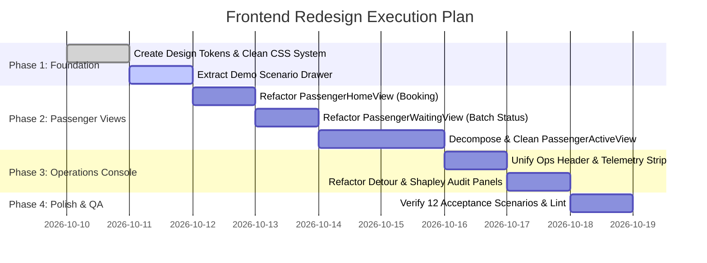

# RoadPool Frontend Redesign & Simplification Plan
**From Cluttered Hackathon Prototype to Feature-Centric, Minimalist Architecture**

---

## 1. Executive Summary & Problem Diagnosis

The current RoadPool frontend suffers from **feature and cognitive overload**, failing core UI/UX heuristics (Nielsen #8 *Aesthetic & Minimalist Design*, Krug's *"Don't Make Me Think"*, and Miller's Law of working memory):

1. **Scaffolding / Test Artifact Intrusion**: Developer verification badges (`Ticket 11 Verified`, `Ticket 09 Verified`), raw algorithm names (`Google OR-Tools PDP`), and simulation trigger buttons (`Simulate Compatible Joiner`, `Simulate Detour Rejection`, `Co-Rider Cancel`) are permanently embedded inside end-user screens.
2. **Conflated Archetypes**: Passenger flows (booking, waiting, traveling) and Operations workflows (fleet monitoring, batch windows, detour guarantees) are tangled with persistent evaluator bars (`AcceptanceScenariosBar`, `GuidedStoryOverlay`).
3. **Monolithic, Unmaintainable View Files**: `PassengerActiveView.tsx` is **1,179 lines (55KB)** with duplicate state machines, nested cards inside cards, and over 7 competing buttons on a single screen.
4. **Visual Clutter**: Oversaturated badge colors, heavy glows (`shadow-glow`), arbitrary card padding, and excessive explanatory paragraphs on every screen.

### Guiding North Star: *Feature-Centric Minimalism*
> **"Perfection is achieved not when there is nothing more to add, but when there is nothing left to take away."**
> Simplicity does not mean deleting core features; it means removing every decorative obstacle, redundant metric, and test chrome between the user and their immediate task.

---

## 2. Target Design Architecture

```mermaid
graph TD
    App[App Shell] --> Nav[Minimal Header: Mode Toggle + Live Connection]
    App --> MainArea[Active Workspace]
    App --> DemoDrawer[Collapsible Demo & Scenario Drawer (Floating / On-Demand)]

    MainArea --> PassengerApp[Passenger Experience (Clean & Mobile-First)]
    MainArea --> OpsConsole[Operations Console (Unified Dispatch Center)]

    PassengerApp --> P1[1. Book: Simple Pickup, Dropoff, Seats]
    PassengerApp --> P2[2. Match: Batch Countdown, Status, Transparent Fare]
    PassengerApp --> P3[3. In-Ride: Live Map, Cabin Seats, Detour & Shapley Breakdown]

    OpsConsole --> O1[Fleet Live View & Map Tracking]
    OpsConsole --> O2[Batch Window & Demand Queue]
    OpsConsole --> O3[Routing & Detour Guarantee Audit]
    OpsConsole --> O4[Shapley Fair Fares Cooperative Allocation]
```

### Core Design Pillars

| Dimension | Current State | Target Redesign (Using `minimalist-ui` & `impeccable:distill`) |
|---|---|---|
| **Evaluator Chrome** | Persistent 64px runner bar + in-page test buttons | **Drawer Pattern**: Isolated into a slide-over/docked "Test Scenarios & Demo" panel triggered via hotkey `D` or a discreet corner pill. Completely absent from standard user flows. |
| **Color & Surfaces** | 8+ saturated colors, glowing cyan/yellow containers | **Monochrome + 1 Semantic Accent**: Clean off-white (`#FBFBFA` / `#FFFFFF`), slate-neutral borders (`#E5E7EB`), deep charcoal typography (`#111827`), restrained Emerald/Amber/Rose for live states. |
| **Typography** | Heavy banners, redundant paragraphs, title-case everywhere | Clean geometric sans with strict scale (Display 24px, Section 16px, Body 14px, Meta 12px) with `tabular-nums` monospace for prices, ETAs, and detours. |
| **Cards & Elevation** | Cards inside cards with drop-shadows | **Flat Utilitarian Bento**: Crisp 1px borders, 8px/12px corner radii, zero drop-shadows, generous whitespace (`gap-4`, `p-5`). |
| **Component Depth** | 1,100+ line monoliths | **Decomposed Pure Components**: Each view under 200 lines, delegating to focused subcomponents. |

---

## 3. Detailed View-by-View Redesign Specification

### 3.1. App Shell & Navigation ([`App.tsx`](file:///c:/Users/Asus/Desktop/PVG/frontend/src/App.tsx), [`ShellHeader.tsx`](file:///c:/Users/Asus/Desktop/PVG/frontend/src/components/ShellHeader.tsx))
* **Remove**:
  * Persistent `AcceptanceScenariosBar` pinned under the navbar on every screen.
  * Cluttered 8-pill sub-navigation in the global header.
  * Glowing container backgrounds and hackathon branding text.
* **Keep & Refine**:
  * Clean, 48px top bar:
    * Left: **RidePool** logo + subtle live status dot (Connected / Live Replay).
    * Center: Segmented switcher: **Passenger App** | **Operations Console**.
    * Right: Discreet **Demo Scenarios (12)** trigger pill + Story Mode icon.
* **New Component**: `DemoScenarioDrawer.tsx`
  * Floating slide-over containing the 12 hackathon acceptance scenarios and story mode wizard. Keeps all evaluator testing 100% accessible with one click without polluting production UI.

---

### 3.2. Passenger Experience

#### Step 1: Book Ride ([`PassengerHomeView.tsx`](file:///c:/Users/Asus/Desktop/PVG/frontend/src/views/passenger/PassengerHomeView.tsx))
* **Eliminate**: Giant explanation headers, redundant Pune Metro badges, complex accordion options.
* **Streamline**:
  * **2-Column Layout**: Left side = clean booking card (Pickup, Dropoff, Party Size: 1-4 with counter, estimated fare preview); Right side = interactive route map.
  * **Quick Presets**: 4 minimal pill chips for Pune hubs (Hinjewadi, Swargate, Viman Nagar, Pune Station).
  * **One Clear Primary CTA**: `"Find Pooled Ride"` (disabled while fetching route, instant transition).

#### Step 2: Batching & Match Countdown ([`PassengerWaitingView.tsx`](file:///c:/Users/Asus/Desktop/PVG/frontend/src/views/passenger/PassengerWaitingView.tsx))
* **Eliminate**: Secondary simulation buttons, duplicate request list tables, walls of text explaining batch windows.
* **Streamline**:
  * **Central Focused Status Card**:
    * Clean circular/linear progress bar displaying: *"Finding co-riders on your corridor (28s remaining)"*.
    * Corridor summary: *Shivajinagar → Hinjewadi IT Park*.
    * Upfront Fare Guarantee: *Estimated ₹85 (solo ₹145, saving ~41%)*.
  * **One Primary Action**: Cancel Request (with clear confirmation) or `"View Ride Details"`.

#### Step 3: In-Ride Active Dashboard ([`PassengerActiveView.tsx`](file:///c:/Users/Asus/Desktop/PVG/frontend/src/views/passenger/PassengerActiveView.tsx))
* **Eliminate**:
  * "Ticket 11 Verified" / "Ticket 09 Verified" badges.
  * "Simulate Compatible Joiner", "Simulate Detour Rejection", "Co-Rider Cancel" header buttons (relocate to Demo Drawer).
  * Redundant multiple vehicle selector bars.
* **Streamline into 3 Focused Panels**:
  1. **Live Route & Vehicle Tracker**: Map with vehicle location, remaining stops, and ETA countdown.
  2. **Minimal Cabin Occupancy Grid**: Clean 4-seat visual showing who is currently aboard (privacy-safe: "You", "Co-rider 1", "2 Seats Free").
  3. **Fair Fare Transparency Card**:
    * Total Ride: *₹82.50* (locked max detour ≤ 15%).
    * One-tap button: *"View Shapley Savings Breakdown"* (opens slide-over sheet).
    * Responsive inline card for Two-Way Consent: only appears when a mid-trip co-rider requests to join, with plain "Accept" / "Decline" buttons.

---

### 3.3. Operations Console (Fleet, Dispatch & Detour Audit)

Consolidate the 5 fragmented Ops views into **1 unified Operations Workspace** with clean tabbed navigation:

```
[ Operations Console ]
├── [Fleet & Map]       -> Live Pune map + active vehicle cards (occupancy, current stop)
├── [Batch Intake]      -> Current 45s window timer, pending requests queue, manual "Dispatch Now"
├── [Detour Guarantees] -> Table of audited passenger insertions with strict ≤15% compliance proofs
└── [Fair Fares (Shapley)] -> Cost allocation matrix & cooperative game theory verification
```

* **Eliminate**:
  * Repetitive 100px banners at the top of every single view.
  * Duplicated KPI tiles across views (standardize in a unified top metrics strip).
* **Refine**:
  * **Fleet Telemetry Strip**: 4 compact monospace metrics: Active EV Fleet (10/10) | Avg Pooling Occupancy (2.8/4) | Fleet Detour Avg (8.4% ≤ 15%) | Total Savings Allocated (₹1,420).
  * **Detour Audit Table**: High-density, scannable table with green check for `≤15% Compliant` and red badge for `Rejected (>15%)`, clicking any row shows mathematical proof drawer.

---

## 4. Phased Implementation Roadmap



### Phase 1: Foundation & Scaffolding Isolation (Day 1)
- [x] **Task 1.1**: Update [`index.css`](file:///c:/Users/Asus/Desktop/PVG/frontend/src/index.css) and [`tailwind.config.js`](file:///c:/Users/Asus/Desktop/PVG/frontend/tailwind.config.js) to adopt the `minimalist-ui` token set (flat 1px borders, warm gray neutrals, clean monospace metrics, zero heavy drop-shadows).
- [x] **Task 1.2**: Create `DemoScenarioDrawer.tsx` to encapsulate the 12 acceptance test runners and Guided Story Mode in a clean, non-intrusive floating trigger.
- [x] **Task 1.3**: Simplify [`ShellHeader.tsx`](file:///c:/Users/Asus/Desktop/PVG/frontend/src/components/ShellHeader.tsx) to only show brand, Passenger/Ops toggle, and connection status.

### Phase 2: Passenger Flow Refactoring (Day 2 - 3)
- [x] **Task 2.1**: Refactor [`PassengerHomeView.tsx`](file:///c:/Users/Asus/Desktop/PVG/frontend/src/views/passenger/PassengerHomeView.tsx) into a single-purpose booking layout.
- [x] **Task 2.2**: Refactor [`PassengerWaitingView.tsx`](file:///c:/Users/Asus/Desktop/PVG/frontend/src/views/passenger/PassengerWaitingView.tsx) to present an uncluttered matching progress card.
- [x] **Task 2.3**: Decompose [`PassengerActiveView.tsx`](file:///c:/Users/Asus/Desktop/PVG/frontend/src/views/passenger/PassengerActiveView.tsx) (1,179 lines) into clean modular components:
  - `ActiveTripHeader.tsx` (Vehicle, Destination, ETA)
  - `ActiveTripFarePanel.tsx` (Current fare, Shapley button)
  - Extracted modular cabin occupancy & transparent fare cards.
  - Relocated mock simulation buttons to `DemoScenarioDrawer`.

### Phase 3: Operations Console Consolidation (Day 4)
- [x] **Task 3.1**: Standardize KPI telemetry header across Ops views (`OpsOverviewView.tsx`).
- [x] **Task 3.2**: Streamline [`DetourGuaranteesView.tsx`](file:///c:/Users/Asus/Desktop/PVG/frontend/src/views/ops/DetourGuaranteesView.tsx) and [`FairFaresView.tsx`](file:///c:/Users/Asus/Desktop/PVG/frontend/src/views/ops/FairFaresView.tsx) into dense, high-readability audit tables.
- [x] **Task 3.3**: Ensure route optimization and batch dispatch triggers are intuitive and prominent (`RouteOptimizationView.tsx`, `BatchManagerView.tsx`, `SimulationControlBar.tsx`).

### Phase 4: Verification & Quality Assurance (Day 5)
- [x] **Task 4.1**: Run `npm run test` (verify all 34 vitest unit tests pass).
- [x] **Task 4.2**: Verify all 12 Hackathon Acceptance Test Scenarios function accurately via the new `DemoScenarioDrawer`.
- [x] **Task 4.3**: Fix React useEffect warnings in `oxlint` (0 errors, 0 warnings) and test production build (`npm run build` succeeds cleanly).

---

## 5. Risk Assessment & Safe Refactoring Rules

1. **Zero Regression on Business Logic**:
   - WebSocket hooks (`useSimulationSocket`), Shapley calculations (`shapleyService`), and routing calls (`routingService`) will remain untouched.
   - Refactoring is strictly UI presentation, layout hierarchy, and component modularity.
2. **Deterministic Test Scenario Preservation**:
   - The 12 acceptance scenarios required by evaluators (`Ticket 11`) remain 100% accessible and functional inside the dedicated `DemoScenarioDrawer`.
3. **Responsive Breakpoints**:
   - Passenger App will be strictly optimized for mobile and desktop viewports.
   - Operations Console will be optimized for desktop widescreen monitoring (1280px+).
